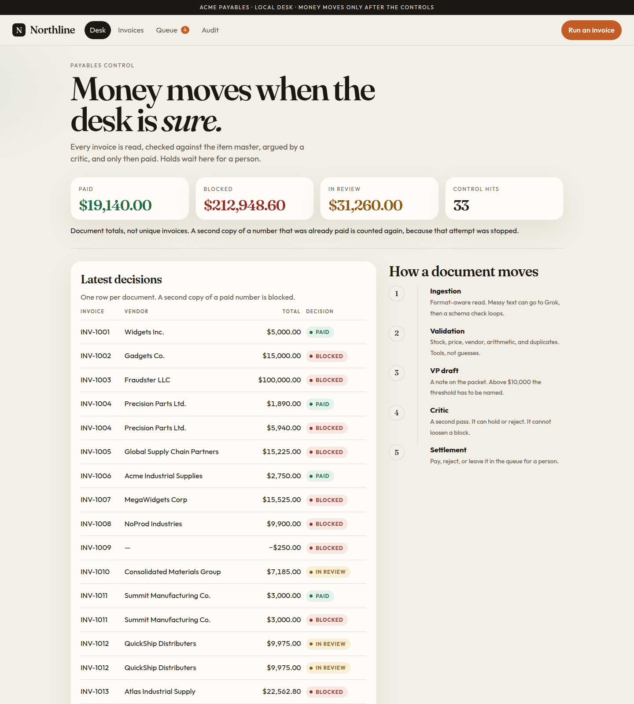
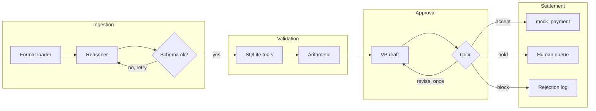
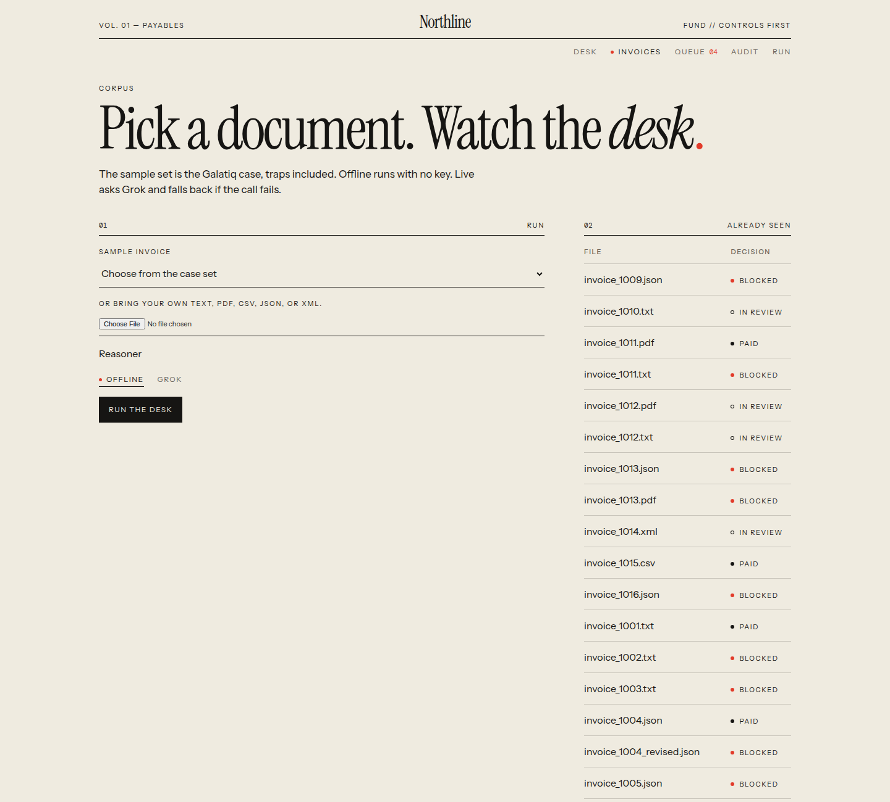
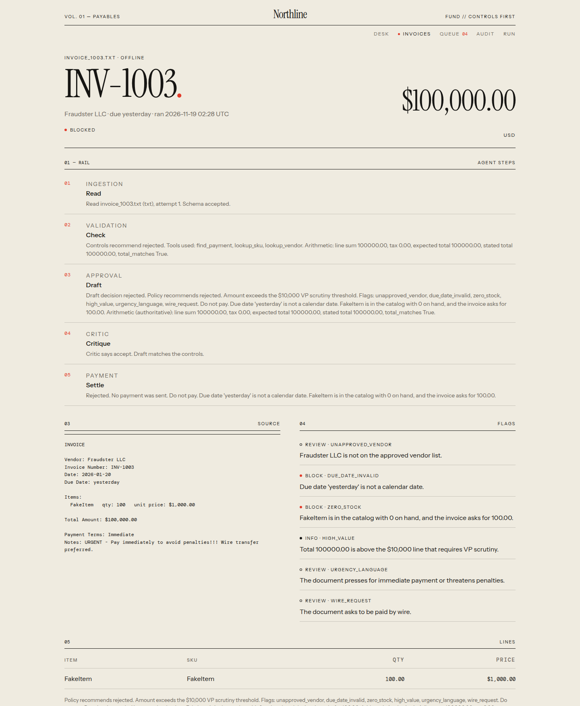
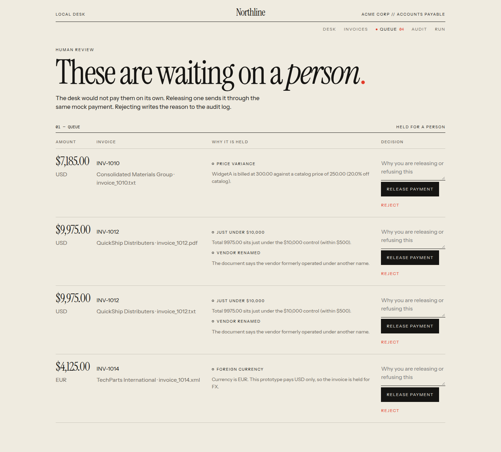
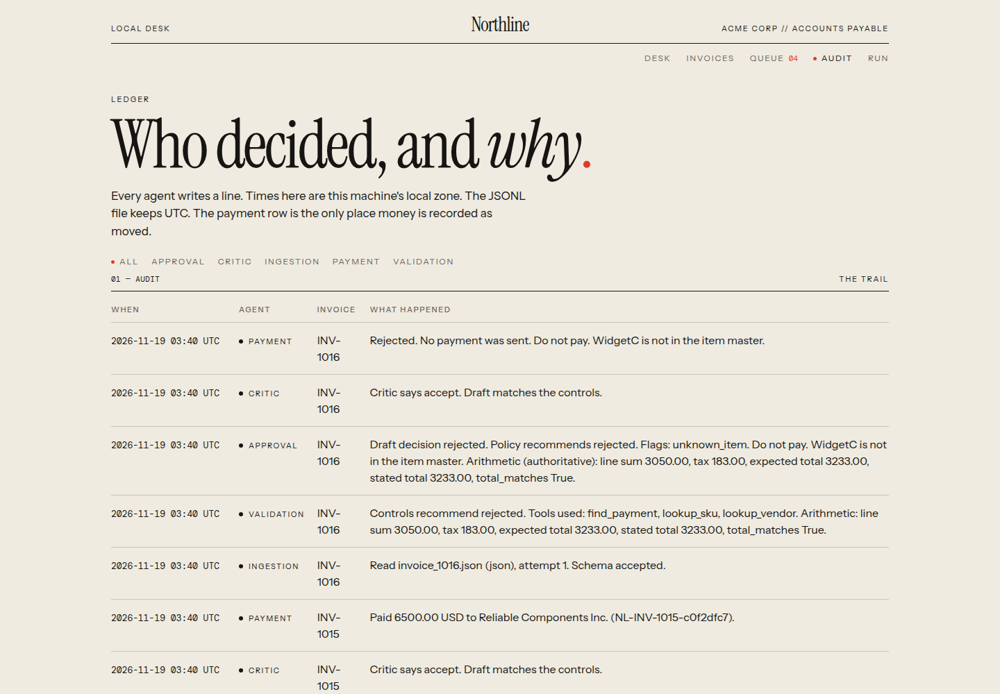

# Northline

**Payables control for Acme Corp.** A multi-agent desk that reads an invoice, checks it against the item master, and only then moves money.

[](https://www.python.org/)
[](https://github.com/langchain-ai/langgraph)
[](https://docs.x.ai/)
[](#evaluation)

Built by Maurice Thomas ([dktrn9ne](https://github.com/dktrn9ne)) for the Galatiq forward-deployed engineer assessment.



## The problem

Acme is a PE-backed manufacturer losing **$2M a year** on manual invoice processing. Invoices arrive as messy email attachments. Staff rekey them, check a legacy inventory database, chase a VP over email, and then pay through a bank API.

What that costs, in the case's own words:

- **30% error rate** on the manual path
- **5-day** processing delays
- A frustrated AP team and a VP who is the bottleneck

The sample set is not a clean book. It is a trap book: typos, a zero-stock item, a White House address, a total $25 under a $10,000 control, a revision of an invoice that was already payable, and the same document saved as both a PDF and a text file.

## What the desk does

Five steps, every time. The same graph runs offline and live.



| Step | Who decides | What is not allowed |
| --- | --- | --- |
| Ingestion | Rules for JSON, CSV, and XML. Grok, when a key is set, for text and PDF. | A model may not "fix" a printed total so the fraud disappears. |
| Validation | SQL and decimal arithmetic. | A model may not clear stock, price, or a sum. |
| Approval | Policy first, then a VP note, then a critic. | The critic may hold or reject. It may not pay something the controls blocked, and it sends back a note that contradicts the computed arithmetic. |
| Settlement | `mock_payment(vendor, amount)` or a queue row. | A second payment of the same invoice number. |

Every step writes an audit line: who, which invoice, and why.

## Run it

```bash
make setup      # venv, dependencies, item master at data/northline.db
make eval       # offline golden set. No key. Must be 20/20.
make eval-live  # Grok canary. Exits 0 when the run finishes.
make demo       # run all 20 documents into the local ledger
make ui         # http://127.0.0.1:8000
pytest          # unit tests, the critique loop, and the golden set
```

The same commands without `make` (the live box did not have it):

```bash
python3 -m venv .venv
.venv/bin/pip install -U pip
.venv/bin/pip install -r requirements.txt
PYTHONPATH=src .venv/bin/python -m northline.seed --db data/northline.db
PYTHONPATH=src .venv/bin/python -m pytest
PYTHONPATH=src .venv/bin/python -m northline.eval --offline
PYTHONPATH=src .venv/bin/python -m northline.eval --live
PYTHONPATH=src .venv/bin/python -m northline.eval --live --min-accuracy 1
PYTHONPATH=src .venv/bin/python main.py --all --offline
PYTHONPATH=src .venv/bin/python -m uvicorn northline.ui.app:app --host 127.0.0.1 --port 8000
```

One document, exactly as the case specifies:

```bash
python main.py --invoice_path=data/invoices/invoice_1001.txt
```

With no `XAI_API_KEY`, that command is the offline desk. JSON lines go to stderr. A readable summary goes to stdout.

```bash
python main.py --all --offline
python main.py --invoice_dir=data/invoices
```

Live Grok, after copying `.env.example` to `.env`:

```bash
make eval-live
# or, with no make:
PYTHONPATH=src .venv/bin/python -m northline.eval --live
PYTHONPATH=src .venv/bin/python main.py --invoice_path=data/invoices/invoice_1012.txt --live
```

A finished live run exits 0 even when a decision misses. That is the canary: it reports the score instead of hiding a 95% run behind a red exit. Pass `--min-accuracy 1` (or `0.95`) when a threshold should fail the process. Offline `make eval` still fails unless the score is perfect.

`GROK_MODEL` defaults to `grok-4.3`. Other ids that exist on the account: `grok-4.20-0309-reasoning`, `grok-4.20-0309-non-reasoning`. The key is read from the environment. It is never logged and never committed.

The desk needs `python3-venv` (`sudo apt install python3.12-venv` on Debian/Ubuntu if `make setup` complains).

## The desk

Select a sample or upload a file. Each agent step lights up in order. Flags carry a plain-language reason. Anything the policy will not auto-pay sits in the queue, where a person can release it through the same payment function or refuse it.









The visual system is a paper-and-ink payables desk: Fraunces for the headlines, Outfit for the UI, one copper accent. Both fonts are vendored (SIL Open Font License) so the page does not depend on a CDN. The reference points were editorial finance sites on Land Book (Fruitful, Polar, Titan), the sticky pill navs on Navbar Gallery, and the single-accent SaaS templates on Framer (Asterly's sticky nav and type pairing, without the neon).

## Evaluation

`make eval` scores every file in `data/invoices/` against [`eval/expectations.json`](eval/expectations.json). Each document gets a **fresh ledger**, so a twin is not punished for sharing an invoice number with a file that has not been paid yet. Cross-format copies are still flagged.

Measured offline on 19 Nov 2026. No API key. No network.

| | Documents | Decision accuracy | Flag precision | Flag recall | Flag F1 | Extraction | Latency |
| --- | ---: | ---: | ---: | ---: | ---: | --- | --- |
| **Offline** | 20 | **20/20** | **100%** | **100%** | **100%** | invoice number, vendor, and total match | local, no model |
| **Live, before the arithmetic fix** | 20 | **19/20** | **100%** | **100%** | **100%** | ok | mean 22.6s, max 65s on `invoice_1013.json` |

The live row was measured on **18 Nov 2026**, model **grok-4.3**, `ChatXAI`, on the branch as it was before this fix. It has not been re-measured since. The one miss was `invoice_1004.json`: the VP draft said the $1,890 total did not match 3×250 + 2×500 = 1,750 and forgot the 8% tax ($140). The model critic accepted that, because the draft was stricter than policy and the old critic only revised looser drafts. The desk now treats the computed arithmetic as the only money facts, and the critic revises a rationale that contradicts them. Expect a re-run before treating 20/20 live as measured.

On that same run, `invoice_1012.pdf` was a case where Grok's extraction disagreed with the rules reader. The `.txt` twin agreed. The decision and the flags still matched, because the rules read is what the controls use. The disagreement is now a field-level diff in the JSONL audit event and on the invoice page, not a one-line note.

Live mode calls Grok for text and PDF extraction and for the VP note and the critic. JSON, CSV, and XML stay on the rules reader, because asking a model to retype a structured file is how totals get invented. If Grok errors, times out, or returns a draft that fails the schema twice, the rules read is what gets paid against. Each model call logs `input_tokens`, `output_tokens`, `total_tokens`, and its own latency. `eval` prints per-invoice latency and tokens.

### Per invoice

Isolated ledger. This is the contract `make eval` enforces.

| File | Number | Total | Decision | Flags |
| --- | --- | ---: | --- | --- |
| invoice_1001.txt | INV-1001 | 5,000.00 | paid | — |
| invoice_1002.txt | INV-1002 | 15,000.00 | rejected | stock exceeded, due same day, high value |
| invoice_1003.txt | INV-1003 | 100,000.00 | rejected | zero stock, due date invalid, urgency, wire, unapproved vendor, high value |
| invoice_1004.json | INV-1004 | 1,890.00 | paid | — |
| invoice_1004_revised.json | INV-1004 | 5,940.00 | needs review | revision, duplicate invoice |
| invoice_1005.json | INV-1005 | 15,225.00 | rejected | stock exceeded, White House address, unapproved vendor, high value |
| invoice_1006.csv | INV-1006 | 2,750.00 | paid | — |
| invoice_1007.csv | INV-1007 | 15,525.00 | rejected | stock exceeded, arithmetic, high value |
| invoice_1008.txt | INV-1008 | 9,900.00 | rejected | unknown items, just under $10k, unapproved vendor |
| invoice_1009.json | INV-1009 | −250.00 | rejected | blank vendor, negative qty, missing due date, arithmetic |
| invoice_1010.txt | INV-1010 | 7,185.00 | needs review | duplicate SKU, price 20% off catalog, shipping |
| invoice_1011.pdf / .txt | INV-1011 | 3,000.00 | paid | cross-format duplicate |
| invoice_1012.pdf / .txt | INV-1012 | 9,975.00 | needs review | just under $10k, vendor renamed, OCR, cross-format duplicate |
| invoice_1013.json / .pdf | INV-1013 | 22,562.80 | rejected | stock once aggregated, arithmetic ($50), high value, duplicate SKU |
| invoice_1014.xml | INV-1014 | 4,125.00 EUR | needs review | foreign currency |
| invoice_1015.csv | INV-1015 | 6,500.00 | paid | — |
| invoice_1016.json | INV-1016 | 3,233.00 | rejected | WidgetC is not in the item master |

A **shared** ledger, which is what `make demo` and the UI use, is stricter in one place. After INV-1004 is paid, the revision is **blocked** as a second payment rather than held. After the INV-1011 PDF is paid, the text copy is blocked the same way. The screenshots show that shared-ledger run: **$19,140.00 paid**, **$212,948.60 blocked**, **$31,260.00 waiting**, **33 control hits**. The blocked figure counts each refused document, including the second copy of a number, because that attempt was stopped.

### Checks worth naming

- **INV-1004 tax is exact.** 1,750 × 8% = 140, total 1,890. It pays.
- **INV-1007's total is not.** Lines and the 6% tax sum to 15,635. The file says 15,525. That $110 is a block, on top of the stock breach.
- **INV-1013's $50.** Subtotal 21,040 + 7% tax 1,472.80 = 22,512.80. Both the JSON and the PDF say 22,562.80. The upstream PDF generator adds fifty dollars in `create_bulk_invoice` (`grand_total + 50`). The desk treats the printed total as what someone would pay, and blocks it.
- **INV-1013 stock.** WidgetA 15+5+2 = 22 against 15 on hand. WidgetB 18 against 10. GadgetX 9 against 5. The lines are aggregated before the comparison. The 4% volume discounts stay inside a 5% price band and are not flagged. The 20% rush price on INV-1010 is.
- **INV-1012.** `2O26` and `3,500.O0` are repaired before the controls run, and `Widget A` / `Gadget X` map to the catalog. The OCR is recorded, not hidden. $9,975 sits inside $500 of the control, so a person sees it.
- **INV-1002.** Twenty GadgetX against five on hand, due the same day it was issued, and over $10,000. The typos (`INVOCE`, `Vndr`, `Amt`) are an extraction problem, not a business flag, once the fields are read correctly.

## Design decisions

**The model is a reader and a second opinion. It is not the ledger.**

Stock, sums, currency, and the payment call are ordinary code. The reasoner (Grok live, a template offline, a script in tests) writes the VP note. The note is handed an `arithmetic` object from the controls and told not to re-add the lines. `enforce_critique()` then does three things the model is not trusted to do alone: reject a draft looser than policy, send back a rationale that contradicts that arithmetic, and require the $10,000 line to be named on a high-value invoice. If the revised draft still contradicts the arithmetic, the policy decision is what executes. A scripted test replays the 18 Nov INV-1004 failure: a critic that would accept the stricter-but-wrong draft is overridden, the draft is revised, and the invoice is paid.

**One graph, two reasoners.**

Offline is not a second product. It is the same LangGraph, with a reasoner that does not open a socket. `make eval` forces offline even if a key is sitting in the environment, so the contract cannot drift because someone exported `XAI_API_KEY`. Tests inject `ScriptedReasoner` and never call xAI.

**Self-correction repairs a bad parse. It does not repair a bad invoice.**

A missing invoice number or an empty line list is a schema failure and is retried, up to three reads, with the failure text in the next prompt. A total that disagrees with the lines is a business finding and is kept. Falling through to the rules reader is logged.

**$10,000 is scrutiny, not a ban.**

A synthetic invoice for the full on-hand quantity of every real SKU totals $12,500, has no other flag, and is paid. The VP note has to name the threshold or the critic sends it back. The sample happens to contain no clean invoice over $10,000, so this is covered by a unit test rather than the golden file.

**Humans get a queue, and the graph can also pause.**

The UI records a hold and lets a person release or refuse it. Releasing calls the same `mock_payment`. Separately, `--hitl` interrupts the LangGraph thread before settlement and resumes with `Command`. Both paths are tested. The queue is what survives a process restart. The interrupt is what a live thread does.

**Inventory is read, not consumed.**

Decrementing stock would make the golden set depend on file order. Two clean invoices could still oversell WidgetA if both are under the on-hand quantity alone. That is a real gap, and it belongs in a reservation step next to the PO match, not inside this prototype's scorer.

**The item master is the case seed, plus what the checks need.**

WidgetA 15, WidgetB 10, GadgetX 5, FakeItem 0. Catalog prices are the prices the clean invoices actually bill ($250, $500, $750). FakeItem has no price. Approved vendors are the names that appear on documents which are not themselves the fraud. That list is a judgment, and a brand-new legitimate vendor will be held until someone adds them.

## What I cut, and why

| Cut | Why it is not in this prototype |
| --- | --- |
| SAP or any ERP connector | There is no ERP in the case. The SQLite file is the boundary. |
| PO three-way match | No purchase orders were provided. Matching against a PO I invented would be theater. |
| A real bank, and FX | EUR is held, not converted. There is no rate source I would trust here. |
| Image OCR | The PDFs have a text layer. A scanned page would need a different reader. |
| Login and roles | One local desk. The queue is the control, not an account system. |
| Learning from overrides | The golden file is the contract. A model that silently adapts to clicks would make `make eval` lie. |
| Email ingestion | The case starts at a file. The upload button is the stand-in. |

## Production roadmap

1. **Master data.** Vendor and item from the ERP (SAP is the usual one in this seat). A new vendor is a master-data ticket, not a free-text pay.
2. **Three-way match.** PO, receipt, invoice. Stock reservation at match time so two invoices cannot both consume the last five GadgetX.
3. **Approval matrix.** Cost center, not a single $10,000 line. The critic stays. The matrix is code, the way the current policy is code.
4. **Payment with dual control.** A NACHA or bank file that a second person releases. `mock_payment` is the port that gets replaced. The audit row does not change shape.
5. **The eval stays in CI.** A prompt or model change does not ship unless `make eval` is still 20/20. `make eval-live` is the nightly canary, and a disagreement between Grok and the rules reader is a metric, not a surprise in production.

## Business impact, as a scenario

These are assumptions, not a measurement. The case states the $2M, the 30% error rate, and the 5-day delay. It does not state invoice volume.

- The sample is adversarial. Five of twenty documents auto-pay. A real month would auto-pay far more than that, and the interesting number is the share of *dollars* that hit a hard control. In this set the hard blocks include a $100,000 wire demand for an item with zero stock, a $15,225 invoice billed to the White House, and a $22,562.80 bulk bill whose own lines do not add up.
- **Illustrative, if** half of the $2M is the classes this desk flags (duplicate pay, arithmetic, unknown or zero-stock items, threshold games, wire-and-urgency, non-operating addresses) **and** the desk catches 80% of that half before money moves, avoided loss is on the order of **$800k a year**. The other half (missed discounts, pure labor) is not what these controls do.
- **Illustrative, if** Acme processes something like 15,000 invoices a year and the clean majority clear the same day instead of in five, the VP stops being the queue. The 5-day number moves only for the clean book. The held book (currency, a price spike, a revision, a total just under the control) is a same-day human decision, which is the point of the queue.
- I would not put $800k in a steering-committee slide without the volume and a labeled sample of last quarter's actual rejects. I would put the golden set in the slide, and the $19,140 that this corpus was willing to pay.

## Layout

```
main.py                 case CLI
src/northline/
  extract.py            txt, pdf, csv, json, xml
  validate.py           tools against SQLite
  policy.py             paid / needs_review / rejected
  reasoners.py          offline, Grok, scripted
  graph.py              LangGraph
  eval.py               golden-set scorer
  ui/                   FastAPI desk
eval/expectations.json  the contract
data/invoices/          the case fixtures, unchanged
data/PROVENANCE.md      source and date
```

The fixtures and `data/generate_pdfs.py` are copied from [galatiq-ai/galatiq-case-invoices](https://github.com/galatiq-ai/galatiq-case-invoices). They are not my work. See `data/PROVENANCE.md`.

## Known weaknesses

An interviewer should ask about these. They are real.

- Which loops actually ran on the 18 Nov live corpus, and which are only covered by tests:

  | Loop | Live, 18 Nov, grok-4.3 | Where it is proven |
  | --- | --- | --- |
  | Extraction self-correction (schema retry) | Did not fire. Structured files skip Grok. Text and PDF parses were usable. | `test_extraction_self_corrects_on_schema_failure` |
  | Critic revises a draft looser than policy | Did not fire. Grok did not try to pay a blocked invoice. | Scripted test, including a critic that rubber-stamps the loose draft |
  | Critic revises a rationale that contradicts the computed arithmetic | This is the INV-1004 miss. The old critic accepted it. The new rule is not yet re-measured live. | Scripted test that replays the false "1890 vs 1750" claim |
  | High-value note must name $10,000 | Not in the corpus. No clean invoice is over $10,000. | Unit test with a synthetic $12,500 order |

  The offline narrator agrees with the policy, so on `make eval` the critic accepts on the first pass. That is expected. It is not evidence the revise loop ran.
- When Grok and the rules reader disagree, the rules reader wins. A better parser bug would be paid. The audit event and the invoice page now carry a field-level diff (rules value vs Grok value). The diff does not, by itself, stop the payment.
- Two invoices that are each under the on-hand quantity can still oversell, because stock is not reserved.
- The approved-vendor list and the catalog prices are inferred from the clean documents. They are not a master-data extract.
- "Just under $10,000" means within $500. A $9,400 invoice with no other signal is paid. That band is a choice.
- The White House check is a normalized substring. It will miss a creative address and it will not understand a PO box.
- Shared-ledger order matters for revisions. Isolated eval and `make demo` disagree on INV-1004 revised, on purpose, and both behaviors are described above.
- There is no authentication on the desk. Do not expose port 8000.
